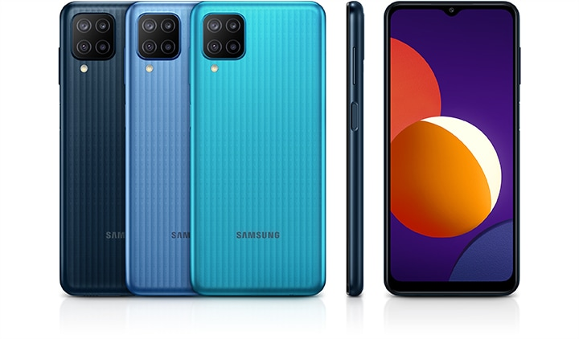

# Samsung Galaxy M12 — SM-M127F

<div align="center">
  <a href="https://www.samsung.com/ae/business/smartphones/galaxy-m/galaxy-m12-green-64gb-sm-m127fzggmea/">
    
  </a>
  <br>
  <sub>Render produk dari <a href="https://www.samsung.com/ae/business/smartphones/galaxy-m/galaxy-m12-green-64gb-sm-m127fzggmea/">halaman resmi Samsung</a>; gambar untuk ilustrasi.</sub>
</div>

Repositori ini berisi **source kernel Samsung Galaxy M12 SM-M127F** dari paket open-source Samsung Android 13, beserta source platform pendamping yang ada di paket. Samsung mencantumkan firmware **M127FXXS9DXJ1** dan **M127FXXS9DXJ3** pada entri sumber yang sama. Karena itu, arsip ini adalah paket sumber yang terdaftar untuk DXJ1—bukan arsip terpisah khusus DXJ1.

## Ringkasan perangkat

| Komponen | Informasi |
| --- | --- |
| Model | Samsung Galaxy M12, SM-M127F |
| Layar | 6,5 inci, HD+ 720 × 1600, Infinity-V |
| Kamera belakang | 48 MP utama, 5 MP ultra-wide, 2 MP depth, 2 MP macro |
| Kamera depan | 8 MP |
| Baterai | 4.900 mAh tipikal, pengisian cepat adaptif hingga 15 W |
| Sistem sumber | Android 13; kernel ARM64; konfigurasi `exynos850-m12nsxx_defconfig` |

Spesifikasi dapat berbeda menurut negara, operator, dan varian produk. Detail layar, kamera, dan baterai merujuk pada [halaman spesifikasi Samsung](https://www.samsung.com/ae/business/smartphones/galaxy-m/galaxy-m12-green-64gb-sm-m127fzggmea/).

## Sertifikasi dan informasi SAR

Informasi berikut merujuk pada dokumen yang dapat dicocokkan dengan model M127F. Sertifikasi radio berkaitan dengan perangkat keras dan wilayah pemasaran, bukan dengan nomor build firmware tertentu.

| Item | Informasi terverifikasi |
| --- | --- |
| FCC ID | `A3LSMM127F` |
| Pemegang filing FCC | Samsung Electronics Co. Ltd. |
| Jenis perangkat di filing | GSM/WCDMA/LTE, dengan BT/BLE dan Wi-Fi 2,4 GHz |
| SAR kepala | 0,539 W/kg |
| SAR tubuh | 1,388 W/kg |
| Jarak uji pemakaian di tubuh | 0,5 cm |

FCC ID dan berkas filing untuk SM-M127F dapat ditinjau di [rekaman FCC ID A3LSMM127F](https://fccid.io/A3LSMM127F), yang memuat manual, foto perangkat, laporan SAR, dan laporan pengujian radio. Data SAR di atas berasal dari lookup resmi Samsung untuk varian **SM-M127F/DSN** pada wilayah Irlandia. Samsung menyatakan batas SAR ICNIRP yang dirujuknya adalah 2 W/kg; nilai tersebut merupakan nilai maksimum hasil pengujian pada kondisi standar, dan dapat berbeda antarvarian atau dokumen wilayah. Lihat [halaman SAR Samsung](https://www.samsung.com/sar/sarMain?site_cd=ie&prd_mdl_name=SM-M127F%2FDSN) untuk penjelasan dan data model.

## Isi repositori

- Source kernel berada di direktori akar.
- Source komponen/modul platform Android ada di [`platform/`](platform/).
- Petunjuk build asli Samsung: [`README_Kernel.txt`](README_Kernel.txt) dan [`README_Platform.txt`](README_Platform.txt).
- Asal paket dan batas cakupan versi: [`SOURCE_PROVENANCE.md`](SOURCE_PROVENANCE.md).
- Hash integritas: [`CHECKSUMS.sha256`](CHECKSUMS.sha256).
- ZIP sumber M127F asli tersedia pada [GitHub Release v1.0.0](https://github.com/gunturproject/samsung-m12-m127f-kernel-source/releases/tag/v1.0.0).

## Build kernel

Samsung meminta toolchain AArch64 GCC dan Clang yang sesuai. Perintah dasar dari catatan build Samsung:

```sh
export PLATFORM_VERSION=13
export ARCH=arm64
make exynos850-m12nsxx_defconfig
make
```

Image kernel dihasilkan sebagai `arch/arm64/boot/Image`; modul berada di `drivers/*/*.ko`. Toolchain dan Android build tree tidak disertakan di repo ini, dan build belum diuji saat penyiapan repositori.

## Lisensi

Paket mengandung beberapa komponen dengan lisensi masing-masing. Pertahankan pemberitahuan lisensi pada berkas sumber, termasuk `COPYING` dan direktori `LICENSES/`, serta tinjau lisensi tiap komponen sebelum penggunaan atau redistribusi. Persyaratan unduhan Samsung tidak menggantikan lisensi yang menyertai kode sumber.
